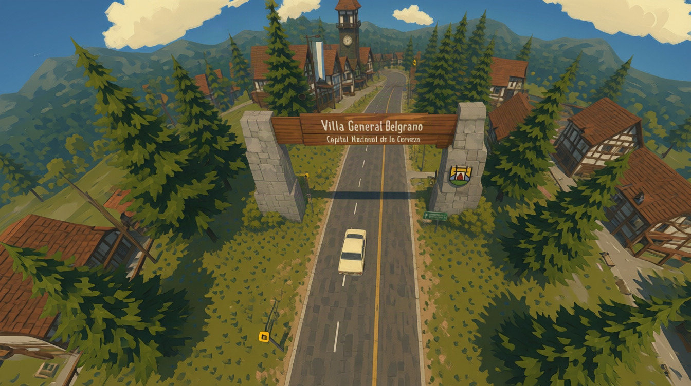

# Calamuchita

Juego de manejo, vuelo y exploración por el Valle de Calamuchita (Córdoba, Argentina) con **geografía real**:
Villa General Belgrano, Los Reartes y Villa Ciudad Parque. Se juega en el navegador.



## Cómo correrlo

```bash
npm install
npm run dev        # abre http://localhost:5173
```

El mundo ya viene generado en `public/world/`. Solo hace falta regenerarlo si cambiás datos o el pipeline (ver abajo).

Para publicar: `npm run build` genera `dist/` (estático; sirve para Netlify, Vercel, GitHub Pages o itch.io).

### Railway

El proyecto ya está listo para Railway (`npm run build` + `npm start`, que levanta `server.mjs` con gzip):

```bash
railway init        # una sola vez: crea el proyecto
railway up          # sube y despliega
railway domain      # genera la URL pública
```

En el celular hay controles táctiles (joystick + botones) y la calidad arranca en "Baja".

## Elegí cómo recorrer el valle

En la pantalla inicial y durante el paseo podés elegir **Auto** o **Avioneta**.
La avioneta **siempre sale desde la pista del Aeroclub de Villa General Belgrano**: tanto al elegirla como al retomar una partida. Acelerá por la pista y mantené **Espacio** para despegar.

Al volver al auto, lo encontrás donde lo habías dejado. Se conservan las postales al cambiar de vehículo. En avioneta, el mapa muestra el aeroclub y permite volver a la pista; para usar viajes rápidos por tierra, elegí Auto.

## Controles del auto y a pie

| Acción | Teclado | Gamepad |
|---|---|---|
| Acelerar / frenar / marcha atrás | `W` / `S` (o flechas) | RT / LT |
| Doblar / caminar | `A` `D` | stick izquierdo |
| Freno de mano / saltar | `Espacio` | A |
| Bajarse o subirse al auto | `E` | X / Y |
| Correr (a pie) | `Shift` | B |
| Mapa | `M` | Select |
| Cambiar cámara | `C` | RB |
| Enderezar el auto | `R` | LB |
| Mirar alrededor / zoom | arrastrar el mouse / rueda | stick derecho |
| Mostrar/ocultar ayuda | `H` | |

## Controles de la avioneta

| Acción | Teclado | Gamepad |
|---|---|---|
| Acelerar / desacelerar | `W` / `S` (o flechas arriba/abajo) | RT / LT |
| Girar | `A` / `D` (o flechas izquierda/derecha) | stick izquierdo horizontal |
| Subir / bajar | `Espacio` / `Shift` | stick izquierdo vertical |
| Volver al aeroclub | `R` | LB |
| Mapa / cámara / ayuda | `M` / `C` / `H` | Select / RB |

En celular, usá el joystick para girar y los botones **Acelerar**, **Desacel.**, **Subir**, **Bajar** y **Aeroclub** para volar.

La partida se guarda sola en el navegador (vehículo elegido, posición del auto y postales descubiertas). La avioneta vuelve al aeroclub al cargar; no se retoma en el aire. «Borrar la partida y empezar» también borra las postales.

Para probar el vuelo directamente: `http://localhost:5173/?auto=1&vehicle=plane` (agregá `&fresh=1` para borrar la partida).

## Qué hay en esta versión

- **Terreno real** de ~8,5 × 13,3 km (relieve de 10 m) + sierras lejanas (Sierras Grandes y Chicas, Champaquí incluido) como fondo.
- **Red vial real de OpenStreetMap** (RP 5, E‑83, S‑271, S‑430, S‑210 y todas las calles), con su superficie: asfalto, adoquín, compactado, ripio y tierra. El auto agarra distinto en cada una.
- **Ríos y arroyos** (Río Los Reartes, Río del Medio, El Sauce, La Toma…) con cauces tallados y **puentes** con barandas.
- **Casas por estilo de pueblo**: alpinas con entramado en VGB, criollas encaladas en Los Reartes, cabañas serranas en Villa Ciudad Parque (huellas reales de OSM + casas procedurales a lo largo de las calles).
- **Hitos**: portal de entrada "Capital Nacional de la Cerveza", Torre del Reloj, capillas, Castillo Romano, Barril Cervecero.
- **~250.000 árboles** (pinares, sauces en las orillas, espinillos), instanciados con dos niveles de detalle.
- **Auto** con física de vehículo (Rapier), **personaje a pie** y **avioneta** con despegue desde el Aeroclub de Villa General Belgrano.
- **26 postales** para descubrir (puntos de interés reales), minimapa y mapa grande.
- Sonido de motor sintetizado (sin archivos de audio).

## Arquitectura

TypeScript + **Three.js** (render) + **Rapier** (física, WASM) + **Vite**. Ver `PLAN.md` para el plan completo.

```
src/
  core/       Game (orquesta todo), GameLoop (física a 60 Hz fija), EventBus, Config (calidad, paleta)
  engine/     Renderer, Physics (heightfield + edificios + puentes + troncos cercanos), Input (teclado/gamepad)
  render/     PaintedMaterial (toon + pinceladas en espacio de mundo), Textures (todas procedurales en canvas)
  world/      WorldData (carga y consultas), Terrain (chunks con LOD), Roads, Buildings, Vegetation, Sky
  player/     PlayerController (a pie ↔ manejando), Vehicle, Character, CameraRig, VehicleAudio
  gameplay/   POI (postales), SaveSystem
  ui/         HUD, Minimap/Mapa, estilos
tools/
  fetch-data.mjs     baja OSM + relieve a tools/raw/   (npm run data)
  build-world.mjs    genera public/world/               (npm run world)
  preview-map.mjs    vista superior para validar        (npm run preview-map → docs/preview-mundo.png)
  test-physics.mjs   chequea que la física coincida con el relieve
```

Coordenadas: el pipeline usa `x` = Este y `n` = Norte en metros, con origen en el centro de Villa General Belgrano (−31.9765, −64.5590). En Three.js, `X = x`, `Z = −n`.

## Regenerar el mundo

```bash
npm run data     # descarga OSM y relieve (necesita internet)
npm run world    # procesa y escribe public/world/
npm run preview-map
```

Correcciones a mano (por ejemplo, la ubicación exacta del portal o POIs que no están en OSM) van en `tools/overrides/world.json`:

```json
{
  "portal": { "x": 1554, "n": 658, "y": 0, "heading": 3.1, "width": 8.5 },
  "pois": [{ "id": "manual-1", "name": "Mirador X", "kind": "viewpoint", "x": 100, "n": 200, "town": "vgb" }]
}
```

## Créditos de datos

- Mapa: © colaboradores de OpenStreetMap (licencia ODbL).
- Relieve: Terrarium elevation tiles (Mapzen / AWS Open Data; SRTM, GMTED y otros).
